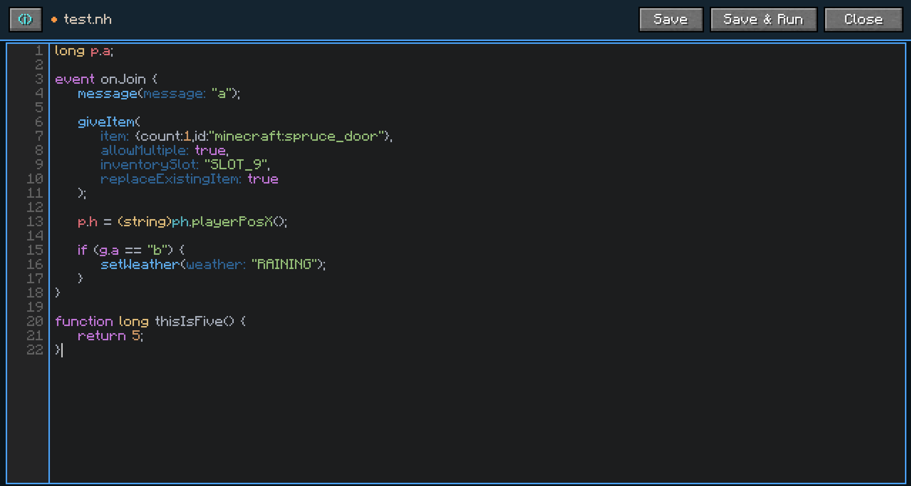

# NeoHouse

Maintained by: @drakou111

---

# Overview

**NeoHouse** is a standalone replacement for [Housing Editor](https://www.housingeditor.com/) and [HTSL](https://github.com/BusterBrown1218/HTSL).

Existing tools like Housing Editor rely on external dependencies such as ChatTriggers and web-based workflows. NeoHouse is code-oriented and fully in-game — no external websites required.

**NeoHouse** provides:

- A fully in-game scripting environment
- A custom-designed coding language
- An integrated IDE with syntax highlighting, autocomplete, and argument hints
- A self-contained workflow

---

# Screenshots




---

# Getting Started

## Download

You can download **NeoHouse** from Modrinth:
<modrinth-link-TODO>

Choose the version and mod loader that matches your setup, then place the `.jar` file into your `mods` folder.

## Requirements

- Minecraft 1.21.x (1.21 → 1.21.11)
- Fabric requires [Fabric API](https://modrinth.com/project/P7dR8mSH)

---

# Supported Versions

**NeoHouse** currently supports:

- Minecraft 1.21 → 1.21.11
- Fabric and NeoForge

---

# Scripting Language

## Types

| Type     | Description |
|----------|-------------|
| `long`   | Whole numbers (e.g. `42`, `-7`) |
| `double` | Decimal numbers (e.g. `3.14d`, `-0.5d`) |
| `string` | Text (e.g. `"hello"`) |
| `bool`   | Boolean — `true` or `false` |
| `var`    | Dynamically typed, no compile-time type checking (not recommended) |

Double literals require the `d` suffix: `3.14d`.

There is also an **Item** type used exclusively in action parameters like `giveItem`. Item values cannot be stored in variables or manipulated — they are raw SNBT data passed directly to the action.

---

## Variables & Holders

Variables are stored in different scopes called *holders*:

| Holder  | Syntax              | Scope |
|---------|---------------------|-------|
| Player  | `p.name`            | Per player, reset on leave |
| Global  | `g.name`            | Shared across all players |
| Team    | `t[teamName].name`  | Shared within a named team |

Variable names are limited to 16 characters.

---

## Global Variable Declarations

Variables that need initializers or explicit types must be declared at the top of the file (outside any function or event):

```java
string g.word = "N/A";
long g.number;
var g.something = 2;
long t[myTeam].score = 0;
```

Only `g.` (global) and `t[...].` (team) variables can have initializers. Player (`p.`) variables cannot have initializers at declaration — assign them inside a function or event instead.

Variables referenced anywhere in the file without a declaration are treated as undeclared `var` globals.

---

## Constants

Named compile-time values. The name is substituted for the literal at every use site — no runtime variable is created.

```java
const long MAX_SCORE = 100;
const double TICK_RATE = 0.05d;
const string PREFIX = "[Game]";
const bool DEBUG = false;
```

Use the name anywhere a literal is valid:

```java
if (p.score >= MAX_SCORE) {
    message(PREFIX + " You win!");
}
```

Rules:
- Must be declared at the top of the file, before any `function`, `event`, `loop`, `command`, or `menu`.
- The value must be a primitive literal or a reference to another already-declared constant.
- The `var` type is not allowed.
- Cannot be assigned to (`MAX_SCORE = 5;` is a compile error).

---

## Placeholders

Placeholders fetch read-only values from the housing or player state. They cannot be assigned to.

Syntax: `ph.placeholderName` or `ph.placeholderName(arg1, arg2, ...)`

Example:
```java
message("Players online: " + ph.housePlayers);
```

---

## String Concatenation

You can build strings by combining string literals, variables, and placeholders using `+`:

```java
message("Hello, " + p.name + "! Score: " + g.score);
```

This is resolved at compile time into the Housing placeholder format (e.g. `%var.player/name%`), so no extra variable actions are emitted.

You can also explicitly cast a value to string using `(string)`:

```java
message((string)(1312) + " points!");
// produces: "1312 points!"
```

The resulting string must not exceed 256 characters.

---

## Casting

You can cast between numeric types and to string:

```java
(long)someDouble      // truncates decimal part
(double)someLong      // converts to decimal
(string)someValue     // converts to string representation
```

Casting a variable to string embeds it as a Housing placeholder:
```java
(string)(p.score)  // becomes %var.player/score% in the final string
```

---

## Operations

**Assignment operators** (left side must be a variable):
```
a = b      a += b     a -= b     a *= b     a /= b
a >>>= b   a >>= b    a <<= b    a &= b     a ^= b    a |= b
```

**Binary expression operators:**
```
a + b   a - b   a * b   a / b
a >>> b   a >> b   a << b   a & b   a ^ b   a | b
```

For strings, `+` performs concatenation (see String Concatenation above).

**Unary operators:**
```
a++   a--   -a   !a
```

**Comparison operators (used in conditions):**
```
a == b   a != b   a >= b   a <= b   a > b   a < b
```

**Constants:**
```
PI   E   HALF_PI   TWO_PI   SQRT_TWO   SQRT_THREE   SQRT_FIVE   PHI
```

---

## Functions

Functions map directly to Housing functions.

```java
function greet() {
    message("Hello!");
}
```

Functions can return values using a return type:

```java
function long add(long left, long right) {
    return left + right;
}

// Call site:
long result = add(1, 2);
```

**Important — parameters are passed by value, not by reference.** Inside the function, parameters are copies of the arguments. Modifying them does not affect the original variables:

```java
function modify(long b) {
    b = 999;  // only modifies the local copy
}

function test() {
    p.x = 5;
    modify(p.x);
    // p.x is still 5 here
}
```

Parameters have no holder prefix — they are implicitly player variables with compiler-generated names.

Functions cannot be named after built-in actions (e.g. `message`, `kill`, `teleport`).

### Global Function Call

Void functions can be triggered for **all players** in the housing using the `global` keyword:

```java
function announce() {
    message("A new round has started!");
}

event onJoin {
    global announce();
}
```

This maps to Hypixel's *Trigger Function (for all players)* action. Only void functions can be called globally — typed functions are not supported.

---

## Loops

Loops are functions that run repeatedly on a fixed tick interval.

```java
loop myLoop(10) {
    // runs every 10 ticks
}
```

The tick delay must be at least `4`. If omitted, it defaults to `4`. Loops cannot be typed or take parameters.

---

## Events

Events are triggered automatically by in-game actions.

```java
event onJoin {
    message("Welcome!");
}
```

Available events:

| Event name          | Trigger |
|---------------------|---------|
| `onJoin`            | Player joins the housing |
| `onQuit`            | Player leaves the housing |
| `onDeath`           | Player dies |
| `onKill`            | Player kills another player |
| `onRespawn`         | Player respawns |
| `onGroupChange`     | Player's group/rank changes |
| `onPvpStateChange`  | PvP is toggled |
| `onFishCaught`      | Player catches a fish |
| `onEnterPortal`     | Player enters a portal |
| `onDamage`          | Player takes damage |
| `onBlockBreak`      | Player breaks a block |
| `onStartParkour`    | Player starts a parkour run |
| `onEndParkour`      | Player completes a parkour run |
| `onDropItem`        | Player drops an item |
| `onPickUpItem`      | Player picks up an item |
| `onChangeHeldItem`  | Player's held item slot changes |
| `onToggleSneak`     | Player starts or stops sneaking |
| `onToggleFlight`    | Player starts or stops flying |

Some events are restricted — for example, `onQuit` allows only 5 actions.

---

## Commands

Custom commands are defined with `command`. Parameters are optional.

```java
command myCmd(priority: 5, listed: false, targeted: true) {
    kill();
}
```

| Parameter  | Default | Description |
|------------|---------|-------------|
| `priority` | `0`     | Command execution priority (0–20) |
| `listed`   | `true`  | Whether the command appears in `/` suggestions |
| `targeted` | `false` | Whether the command targets a specific player |

Command names must be at least 3 characters and cannot conflict with reserved server commands.

---

## Conditionals

Standard `if` / `else` blocks:

```java
if (p.score >= 100 && isSneaking(false)) {
    message("You did it!");
} else {
    message("Keep going...");
}
```

Conditions can use `&&` (AND) or `||` (OR) but not both in the same expression.

---

## Random

Executes one of several blocks at random:

```java
random [
    { message("Option A"); }
    { message("Option B"); }
    { message("Option C"); }
]
```

You can assign a weight multiplier to make one outcome more likely:

```java
random [
    2*{ message("Common"); }   // twice as likely as the others
    { message("Rare A"); }
    { message("Rare B"); }
]
```

All weights are automatically divided by their greatest common divisor before compilation. For example, weights `[4, 8, 12]` become `[1, 2, 3]`. Blocks with no explicit weight default to `1`.

`random` blocks and `if` blocks can be nested freely.

---

## Repeat

`repeat(N)` unrolls its body N times at compile time. It is not a runtime loop.

```java
repeat(3) {
    message("tick");
}

// equivalent to:
message("tick");
message("tick");
message("tick");
```

---

## Import

Split code across multiple `.nh` files:

```java
import "path/to/other.nh";
```

The imported file's contents are inlined at the import point before compilation.

---

## Actions

Actions are the building blocks of Housing scripting. They are called like functions:

| Action | Signature | Description |
|--------|-----------|-------------|
| `message` | `message("text")` | Sends a chat message to the player |
| `title` | `title("title", "subtitle", fadeIn, stay, fadeOut)` | Displays a title/subtitle (ticks) |
| `actionBar` | `actionBar("text")` | Displays text in the action bar |
| `kill` | `kill()` | Kills the player |
| `heal` | `heal()` | Fully restores health and hunger |
| `teleport` | `teleport("LOCATION", preventInsideBlocks)` | Teleports the player |
| `setGamemode` | `setGamemode("GAMEMODE")` | Sets game mode (`SURVIVAL`, `CREATIVE`, `ADVENTURE`, `SPECTATOR`) |
| `setHealth` | `setHealth(value, "OPERATOR")` | Changes health (`SET`, `ADD`, `MULTIPLY`) |
| `setMaxHealth` | `setMaxHealth(value, "OPERATOR", healOnChange)` | Changes max health |
| `setHunger` | `setHunger(value, "OPERATOR")` | Changes hunger |
| `changeVelocity` | `changeVelocity(x, y, z)` | Sets the player's velocity |
| `launchToTarget` | `launchToTarget("LOCATION", strength)` | Launches player toward a location |
| `giveItem` | `giveItem({...}, allowMultiple, "SLOT", replace)` | Gives an item |
| `removeItem` | `removeItem({...})` | Removes an item |
| `clearInventory` | `clearInventory()` | Removes all items |
| `applyLayout` | `applyLayout("name")` | Applies a saved inventory layout |
| `enchantItem` | `enchantItem("ENCHANTMENT", level)` | Enchants the held item |
| `applyPotion` | `applyPotion("TYPE", duration, level, override, showIcon)` | Applies a potion effect |
| `clearPotion` | `clearPotion()` | Removes all potion effects |
| `giveXp` | `giveXp(levels)` | Awards XP levels |
| `playSound` | `playSound("SOUND", volume, pitch, "LOCATION")` | Plays a sound |
| `displayMenu` | `displayMenu("name")` | Opens a custom menu |
| `closeMenu` | `closeMenu()` | Closes the current menu |
| `setTeam` | `setTeam("name")` | Assigns the player to a team |
| `setGroup` | `setGroup("group", demotionProtection)` | Changes the player's group/rank |
| `sendLobby` | `sendLobby("LOBBY")` | Sends the player to a Hypixel lobby |
| `setCompassTarget` | `setCompassTarget("LOCATION")` | Points the compass at a location |
| `setWeather` | `setWeather("WEATHER")` | Sets housing weather |
| `setTime` | `setTime("TIME")` | Sets world time |
| `triggerParkourCheckpoint` | `triggerParkourCheckpoint()` | Sets a parkour checkpoint |
| `failParkour` | `failParkour("reason")` | Fails the current parkour run |
| `dropItem` | `dropItem({...}, "LOCATION", dropNaturally, preventMerge, despawn, pickupDelay, prioritizePlayer, fallbackInventory)` | Drops an item |
| `pause` | `pause(ticks)` | Pauses execution (1–6000 ticks) |
| `setNameTagDisplay` | `setNameTagDisplay(show)` | Shows or hides the player's nametag |
| `cancel` | `cancel;` | Cancels the current event (statement, not a function call) |

---

## Conditions

Conditions are used inside `if(...)` blocks:

| Condition | Signature | Description |
|-----------|-----------|-------------|
| `isSneaking` | `isSneaking(invert)` | Player is sneaking |
| `isFlying` | `isFlying(invert)` | Player is flying |
| `hasHealth` | `hasHealth(invert, "COMPARATOR", value)` | Player health check |
| `hasMaxHealth` | `hasMaxHealth(invert, "COMPARATOR", value)` | Max health check |
| `hasHunger` | `hasHunger(invert, "COMPARATOR", value)` | Hunger check |
| `hasPotion` | `hasPotion(invert, "EFFECT")` | Has a specific potion effect |
| `hasItem` | `hasItem(invert, {...}, "WHAT", "WHERE", "AMOUNT")` | Has an item |
| `isItem` | `isItem(invert, {...}, "WHAT", "WHERE", "AMOUNT")` | Held item check |
| `hasGamemode` | `hasGamemode(invert, "GAMEMODE")` | Player game mode check |
| `isGroup` | `isGroup(invert, "group", includeHigher)` | Player group check |
| `hasTeam` | `hasTeam(invert, "team")` | Player team check |
| `hasPermission` | `hasPermission(invert, "PERMISSION")` | Permission check |
| `inRegion` | `inRegion(invert, "region")` | Player is in a named region |
| `doingParkour` | `doingParkour(invert)` | Player is in a parkour run |
| `isPvpEnabled` | `isPvpEnabled(invert)` | PvP is active |
| `inPortalType` | `inPortalType(invert, "TYPE")` | Player is in a portal |
| `isDamageCause` | `isDamageCause(invert, "CAUSE")` | Damage cause check |
| `isDamageAmount` | `isDamageAmount(invert, "COMPARATOR", value)` | Damage amount check |
| `isFishingEnvironment` | `isFishingEnvironment(invert, "ENV")` | Fishing environment check |
| `isBlockType` | `isBlockType(invert, {...}, matchTypeOnly)` | Broken block check |

Variable conditions use the standard comparison syntax directly in `if` expressions:
```java
if (p.score >= 10) { ... }
```

---

## Menus

Custom inventory menus with clickable slots:

```java
menu myMenu(3) {
    slot0: ({count:1,id:"minecraft:diamond"}) {
        message("You clicked the diamond!");
    }
    slot8: ({count:1,id:"minecraft:barrier"}) {
        closeMenu();
    }
}
```

The number in `menu name(N)` is the number of rows (1–6). Slot IDs are 0-indexed from top-left.

---

## Integrated IDE

**NeoHouse** includes a built-in in-game IDE.

Features:
- Syntax highlighting with customizable themes
- Code suggestions and autocomplete
- Function argument hints
- Auto-indentation and tab support

---

## Notes

This project is still in active development. Features, syntax, and compatibility may change between versions.
