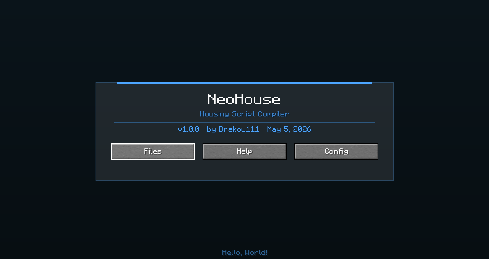

# NeoHouse

Maintained by: @drakou111

---

# Overview

**NeoHouse** is a standalone replacement for [Housing Editor](https://www.housingeditor.com/) and [HTSL](https://github.com/BusterBrown1218/HTSL).

Existing tools like Housing Editor rely on external dependencies such as ChatTriggers and web-based workflows. NeoHouse is code-oriented and fully in-game — no external websites required.

NeoHouse's language has a bit more abstraction than HTSL, but still allows for 1:1 representations if used properly.

**NeoHouse** provides:

- A fully in-game scripting environment
- A custom-designed coding language
- An integrated IDE with syntax highlighting, autocomplete, and argument hints
- A self-contained workflow

---

# Screenshots

---

# Getting Started

## Download

You can download **NeoHouse** from [Modrinth](https://modrinth.com/project/neohouse)

Choose the version and mod loader that matches your setup, then place the `.jar` file into your `mods` folder.

## Requirements

- Fabric requires if using the fabric version [Fabric API](https://modrinth.com/project/P7dR8mSH) 

## Supported Versions

- Minecraft 1.21.2 → 1.21.11
- Fabric and NeoForge

---

# License

**NeoHouse is All Rights Reserved.** The source is publicly viewable for transparency and reference only — you may view the code and use the official compiled releases, but copying, modifying, redistributing, or re-uploading the mod is not permitted without written permission. See [LICENSE](LICENSE) for the full terms.

---

# Notes

This project is still in active development. Features, syntax, and compatibility may change between versions.
